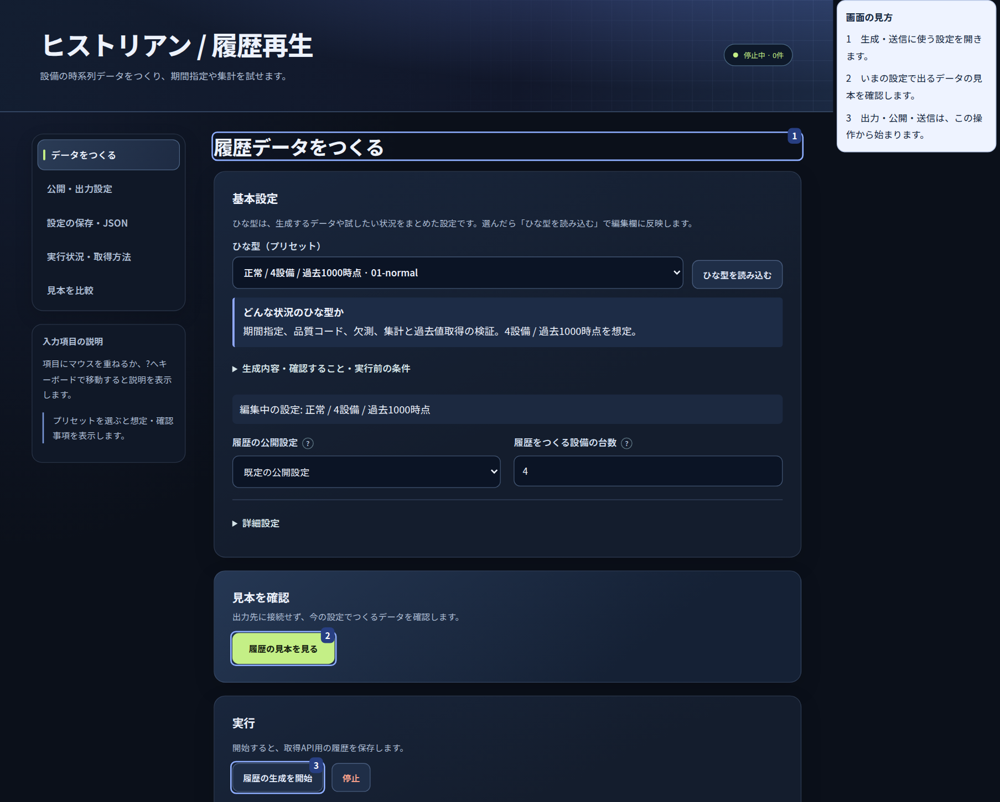

# ヒストリアン模擬 / 履歴・期間取得・集計

12時点の設備履歴を作り、生の記録を読む手順を[初心者マニュアル](docs/user-manual.md)で確認できます。

## 起動して最初の画面を開く

Linux VMに Docker Compose を用意します。別端末からの接続やホスト側のマウントは[VM導入手順](docs/vm-compose.md)を参照してください。

```sh
python3 scripts/init_local.py --env-file .env
docker compose up -d --build
```

VMで `http://127.0.0.1:3642/` を開きます。メニューの「ヘルプ」から、見本の出し方、設定、APIを調べられます。 別端末から管理操作をする場合は[管理画面の認証](docs/vm-compose.md#管理画面の認証)も設定します。

開発時に直接起動する場合は Python 3.12〜3.14 と uv を使用します。必要なPythonは uv でインストールできます。

```sh
uv sync --frozen
DATA_DIR=./data uv run --frozen uvicorn app:app --host 127.0.0.1 --port 3642
```

## 操作と設定の資料

[8アプリの構成](docs/architecture.md)から役割と既定ポートを調べられます。

- [初心者マニュアル](docs/user-manual.md) · [ひな型を選ぶ・作る](docs/preset-guide.md) · [付属のひな型一覧](presets/README.md)
- [設定リファレンス](docs/settings-reference.md) · [JSONの書き方](docs/template-guide.md) · [AI向け作成ハーネス](docs/AI_TEMPLATE_HARNESS.md)
- [APIの使い方](docs/api-guide.md) · [用語集](docs/glossary.md) · [コードを拡張する](docs/code-reading-guide.md) · [変更履歴](CHANGELOG.md) · [レビュー対応表](docs/quality-review.md)
AIクライアント向けの接続方法は[CLI・MCPの使い方](docs/mcp.md)を参照してください。


設備×タグ×時刻のサンプルをSQLiteに保存し、過去値のバックフィルと逐次記録を試験します。値とGood/Bad/Uncertain品質を保存し、論理的なサンプル位置をデータと同一トランザクションで記録します。

| パス | 内容 |
| --- | --- |
| `/source/history/tags` | 保存済みタグ一覧 |
| `/source/history/raw?tag=device-001.value&limit=1000` | 時刻順の生値・品質、署名付き`next`で継続取得 |
| `/source/history/aggregate` | tag / start / end / interval_seconds / functionで集計 |

start/endはタイムゾーン付きISO日時。集計はmean/min/max/sum/count/last、good_only=trueが既定、fill=none/null/previous。欠測を自動で0に置換しません。補完値にはfilled=trueを返します。数値集計では非数値を除外し、lastは元の値を返します。1回のrawは最大1万件、集計は開始・終了を含めて最大1万区間です。たとえば間隔が60秒の場合、開始から9,999分後までで1万区間です。10,000分後までを指定すると HTTP 422 になるため、終了を早めるか間隔を広げてください。

例: `/source/history/aggregate?tag=device-001.value&start=2026-11-14T00:00:00Z&end=2026-11-14T01:00:00Z&interval_seconds=60&function=mean&fill=null`。

sample_secondsは記録上の間隔、interval_msは生成の実時間間隔です。両者を変えると時刻を加速・低速化できます。初期履歴・保持日数・品質異常・欠測・時計の逆転/未来時刻・固着を設定可能。保持期限の掃除は100tickごと、現在のデータセットが対象です。別設定の過去データは容量上限に達するまで残るため、不要な試験データはバックアップ後に管理してください。

これは独自の履歴REST APIです。AVEVA PI、InfluxDB、OPC UA Historical Accessの通信互換はありません。

## 操作ガイド

[ひな型の選び方・詳細設定の画面・自分のひな型の作り方](docs/preset-guide.md)

[](docs/images/operation-guide.png)

1. 計測値の履歴をつくるひな型を読み込みます。
2. 履歴の公開設定と、履歴をつくる設備の台数を確認します。
3. 「履歴の見本を見る」で、記録する項目と値を確認します。
4. 「履歴の生成を開始」で履歴を保存します。取得方法は「実行状況・取得方法」で確認できます。

「詳細設定」を開くと、データ項目・型・生成規則・異常データなどを変更できます。接続方式や認証は「公開・出力設定」で管理し、設定を再利用する場合は「設定の保存・JSON」を使います。

## 設定の保存と運用

1. 「公開・出力設定」で方式・認証・接続先を保存。
2. 「データをつくる」でプリセットを読み込み、任意項目・型・生成器・異常ルールと個別設定を編集。
3. 項目にマウスを重ねるか「?」にフォーカスすると、その場で説明を表示。「履歴の見本を見る」は生成行数の範囲内で最大12件を表示します。たとえば生成行数を1件にすると、見本も1件です。保存済み履歴は上記の取得APIで確認します。
4. 停止してから開始すると新しい設定を適用。実行中は設定とプロファイルの版を固定します。
5. 「設定を保存・JSONで編集」からJSONを編集・検証・取り込み・書き出し・プリセット保存できます。

24種類（通常12・異常12）のJSONを同梱。[一覧と詳細](presets/README.md)には想定・生成条件・確認事項を記載しています。再生成は`uv run python build_presets.py`。初回起動で未登録IDだけを追加し、保存済み設定は更新で上書きしません。

データ型はstring/integer/number/decimal/boolean/datetime/json。record_id、uuid、sequence、分布、重み付きchoice、テンプレート、参照、四則演算、時刻、NULL率、条件上書き、固着・ドリフト・欠落等を指定できます。共有パラメーターは`$名前`、テンプレートでは先行項目を参照。任意Pythonは実行しません。異常ルールの生成位置は各ドライバーが使う論理sequenceであり、必ずしもtickやAPIの読取順ではありません。

公開契約は[Spec JSON Schema](contracts/spec.schema.json)と[Profile JSON Schema](contracts/profile.schema.json)。Spec.version=1、内包するgeneratorは既存ツールと同じRunSpec.version=2です。SQL/ファイル/ストリーム専用の一部設定は内包モデルに残っていますが、このツールのフォームでは使う項目だけを表示します。

## 起動

Python 3.12、uv、Docker Composeを使用します。

```sh
uv sync --frozen
uv run python scripts/init_local.py --env-file .env
docker compose up -d --build
```

`.env`のAPP_PORTが画面のポート、BIND_IPは既定127.0.0.1。直接起動する場合は次のコマンドを使います。

```sh
DATA_DIR="$PWD/data" uv run uvicorn app:app --host 127.0.0.1 --port 8080 --workers 1
```

1アプリ1プロセス・1実行。起動後は停止状態で、画面または操作APIからの開始を待ちます。Docker再作成後もnamed volumeへ設定・データを保持。初期設定は小規模で、速度は保証値ではありません。interval_ms、batch_size、タグ/設備/件数等を増やす場合も、CPU・メモリ・容量上限を合わせて設定してください。

## 認証・データと運用

管理画面と `/api/*` の既定では認証を要求しません。[管理画面の認証](docs/vm-compose.md#管理画面の認証)を有効にすると、操作にもBasic認証が必要です。ローカルまたは信頼済みの検証環境向けです。既定のloopback公開を維持し、他端末から利用する場合は追加認証と到達元制限を別途設けてください。インターネットへの直接公開は避けてください。取得用`/source/*`の認証はプロファイルでnone/basic/bearer/api_key（X-API-Key）から別途選択します。APIへの変更操作は同一オリジンとapplication/jsonを要求。`/healthz` は稼働確認、`/metrics` は管理用のメトリクスです。暗号化HTTPが必要な経路では既存のTLS終端を使用してください。

秘密情報はFernetで暗号化保存し、読み戻し・JSON書き出しから除外。同じ接続範囲なら未入力の資格情報を保持し、接続範囲が変われば引き継ぎません。clear_secretsで明示削除できます。証明書・秘密鍵・CAは画面からconnection-filesへ権限600で配置可能。

DATA_DIRにはsettings.sqlite3、source.key、connection-files、永続データを保存します。DBと暗号鍵は一緒にバックアップし、秘密情報として管理してください。暗号鍵だけを失うと復号できません。リポジトリへ認証情報・実行データは含めません。

ホストメモリ余力（既定6GiB）、ディスク余力2GiB、storage_limit_mbを監視し、閾値で生成を停止します。Composeは既定512MiB/1CPU、非root、read-only root、ログ上限、負荷ガード連携用のラベルを設定。`storage_limit_mb`はDATA_DIR配下の上限で、別マウントのログはローテーションで制限します。

`uv run pytest -q`と`uvx ruff@0.17.6 check --select E4,E7,E9,F .`で検証。[検証記録](VALIDATION.json)に実接続と画面確認の範囲を記載しています。他ソースとの組み合わせとポート割り当ての参考例は[構成メモ](docs/architecture.md)を参照してください。実環境の接続情報は非公開の運用メモで管理してください。

## 外部監視用の管理ラベル

Composeの管理ラベルは既定で `factory.guard.managed=true` です。外部監視側との合意が必要な場合は、非公開の配備設定で `FACTORY_GUARD_LABEL_PREFIX` を指定できます。例えば説明用の値 `synthetic-guard` を指定すると、`synthetic-guard.guard.managed=true` になります。

既存の外部監視との互換性は未確認です。変更前に監視側が照合するラベル名と影響を確認してください。この設定は既存コンテナや監視設定を自動移行せず、デプロイも行いません。

## ライセンス

アプリ本体は[MITライセンス](LICENSE)です。同梱フォントとSwagger UIのライセンスは各配布ディレクトリにあります。
