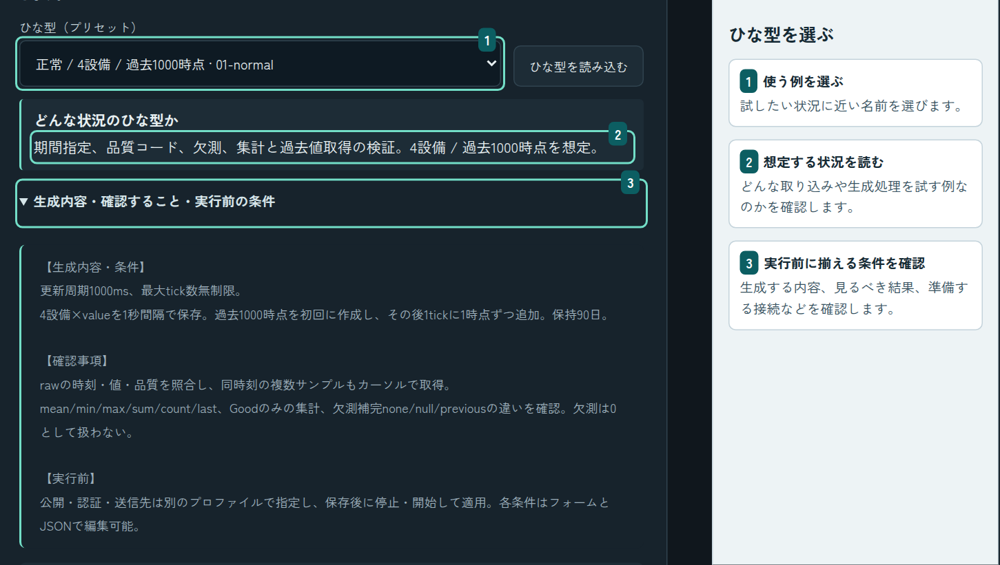
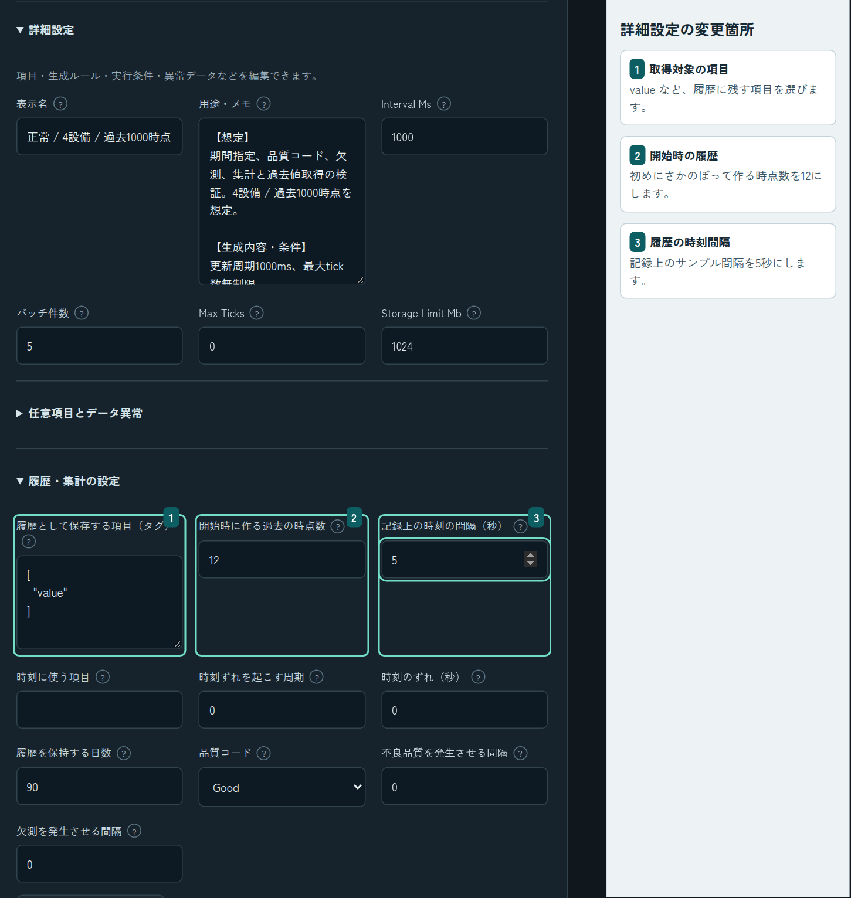
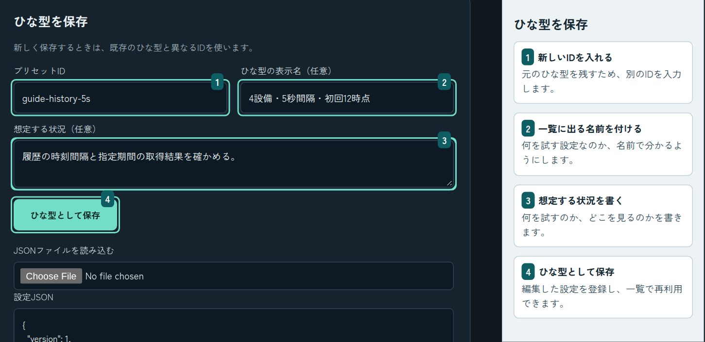
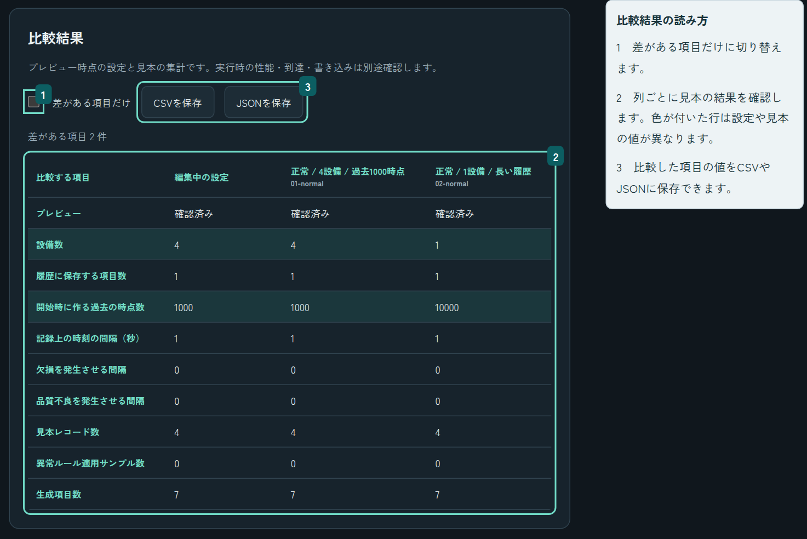

# ヒストリアンのひな型と詳細設定

ひな型（プリセット）は、生成するデータの項目・件数・書式や、再現したい異常をまとめた設定です。試したい状況に近いひな型を読み込み、見本を確認してから必要な設定を変えます。公開、書き込み、送信を始めるときは、画面の実行ボタンを使います。

## ひな型を選ぶ

**正常 / 4設備 / 過去1000時点（01-normal）** を例にします。

設備の計測値を過去にさかのぼって取得し、期間指定と集計を確かめる場面です。元の例は4設備の value を対象とし、開始時に過去1000時点を用意します。

「基本設定」でひな型を選び、「ひな型を読み込む」を押します。

「どんな状況のひな型か」で用途を確認し、「生成内容・確認すること・実行前の条件」で作るデータや準備を読みます。

「異常 / サンプル欠落（13-anomaly）」は記録が抜けた区間を集計でどう扱うか比べるための例です。

全ひな型の用途は[プリセット一覧](../presets/README.md)を参照してください。

## 詳細設定を変更して見本を見る

「詳細設定 → 履歴・集計の設定」を開き、「開始時に作る過去の時点数」を12、「記録上の時刻の間隔（秒）」を5にします。

| 設定 | 変えられること |
| --- | --- |
| 履歴として保存する項目（タグ） | 履歴取得の対象にする生成項目です。 |
| 開始時に作る過去の時点数 | 開始時にさかのぼる時点数です。記録点数には設備数とタグ数も影響します。 |
| 記録上の時刻の間隔（秒） | データ上の時刻の間隔です。アプリが処理を繰り返す周期は別の設定です。 |

**見本での確認**　「履歴の見本を見る」で生成項目と値を確認します。保存後の時刻間隔と初期履歴は、隔離した環境で開始し、生値取得API（raw）で確認します。開始後も時点は追加されます。

## 自分のひな型を作って保存する

1. 上の例で編集した設定を残すには、「設定を保存・JSONで編集」を押します。今の設定がJSON欄に入った保存画面が開きます。
2. 「プリセットID」に `guide-history-5s` のような新しいIDを入力します。半角英数字、ハイフン、下線が使えます。同じIDで保存すると、そのひな型を更新します。
3. 必要に応じて表示名と想定する状況を入力し、「ひな型として保存」を押します。画面で編集した設定は、JSON欄を書き直さず保存できます。
4. 生成画面の「基本設定」に戻り、新しく保存したIDを選んで「ひな型を読み込む」を押します。見本を出し、変更した条件が戻っていることを確認します。

たとえば集計画面の5秒おきと60秒おきの表示を比較するときは、上の例で作ったひな型を読み込み、「記録上の時刻の間隔（秒）」を `60` に変えます。「履歴として保存する項目（タグ）」と「開始時に作る過去の時点数」は揃えたまま、5秒版と60秒版を別々のIDで保存します。

共有するひな型には「4設備・5秒間隔・初回12時点」のような表示名と、「履歴の時刻間隔と指定期間の取得結果を確かめる。」のような用途を書いておくと、次の人が選びやすくなります。接続先と認証は「公開・出力設定」で管理します。ひな型を別環境で使う場合は「JSONを書き出す」で持ち出し、利用先で接続設定を選び直します。

## 複数のひな型を比較する

メニューの「見本を比較」を開きます。記録の間隔、初期履歴、欠損や品質不良を入れる間隔を比べます。

1. 「名前・ID・用途」にキーワードを入力します。よく使うひな型は「お気に入り」を押すと、このブラウザーの「お気に入りのみ」で絞り込めます。「編集画面で選ぶ」を押すと、編集画面でそのひな型が選ばれます。「ひな型を読み込む」を押すと編集欄へ反映されます。
2. 比べたいひな型を最大3件選びます。画面で編集した設定も比べる場合は「編集中の設定を含める」をオンにします。検索条件を変えても選択は維持され、下の「比較する条件」に選んだIDが残ります。
3. 「見本を比較」を押します。複数の候補を順番にプレビューします。「残りを中止」を押すと、処理中のプレビューが終わった時点で残りを止めます。「要確認」の候補は編集画面で設定を見直し、通常のプレビューで詳細を確認します。
4. 比較結果は「差がある項目だけ」で絞り込めます。「CSVを保存」または「JSONを保存」で、ひな型ID・確認状況・比較項目の値を記録できます。接続情報や生成した本文は比較ファイルに含まれません。対象の設定を変えたら比較をやり直します。

[操作ガイドに戻る](../README.md#操作ガイド)
