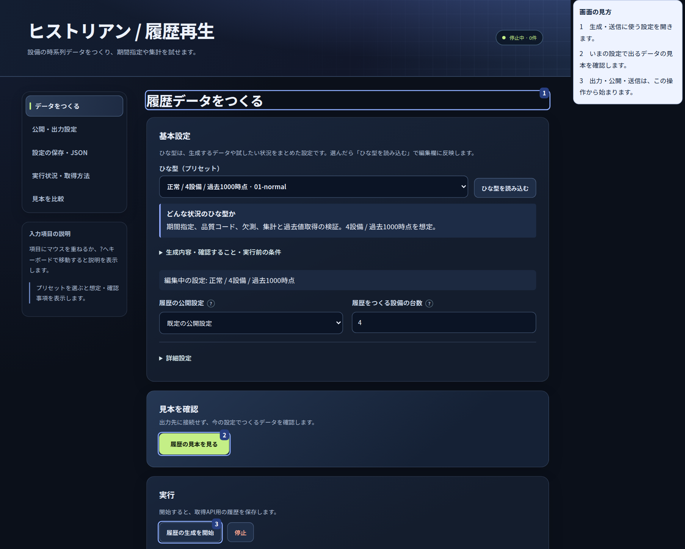

# ヒストリアンシミュレーター 操作マニュアル

履歴収集で、設備の過去値、生値の時系列、品質付きの集計を正しく読めるか検証します。値と品質、記録時刻をSQLiteに保存し、収集側は履歴REST APIから取得します。

## 起動してから結果が出るまで

「履歴の見本を見る」で生成サンプルを確認します。「履歴の生成を開始」で過去の初期履歴を追加し、続いて設定周期で値を記録します。記録上の時刻間隔と、実際の生成周期は別の設定です。

## まず小さく試す

VMで準備する場合は[Docker Compose導入手順](vm-compose.md)で起動し、Web画面を開きます。

1. 設備4台のひな型を読み込み、最初は「過去の時点数」を12、「記録上の時刻の間隔」を5秒にして開始します。
2. VMから `http://127.0.0.1:3642/source/history/tags` を取得し、返ったタグ名を控えます。
3. そのタグを `/source/history/raw?tag=device-001.value&limit=20` の `tag` に入れ、時刻順・値・品質を確認します。期間で絞る場合は `start` と `end` にタイムゾーン付きISO日時を指定します。
4. 同じタグと期間で `/source/history/aggregate` の `function=mean` と `interval_seconds=60` を指定し、生値と1分集計を照合します。欠測は `fill=null` など指定した条件を確認します。

## 停止と再起動

「実行状況・取得方法」で停止し、記録が増えないことを確認します。保持日数による掃除は稼働中の対象データセットに適用され、別の試験データはボリュームに残ります。

## 想定した結果が出ないとき

タグ一覧が空なら履歴生成を開始したか確認します。見本と取得結果の違いは、品質フィルター、期間、記録上のタイムゾーンを順に照合します。

## ひな型・詳細設定

[ひな型を作る・見本を比較する](preset-guide.md)には設定例と注釈付き画像があります。各ひな型の一覧は[プリセット一覧](../presets/README.md)にあります。
